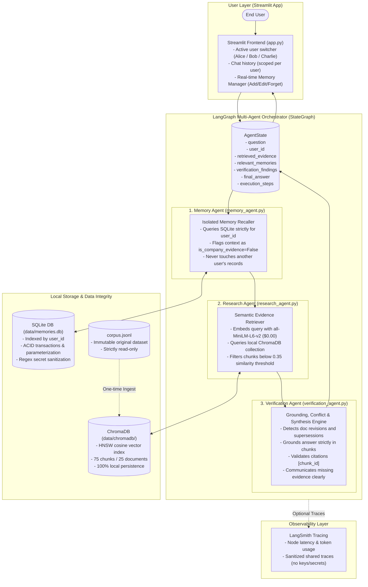

# Asterline Research Assistant ("A Research Assistant That Remembers")

A multi-agent AI research assistant designed to answer questions from the Asterline enterprise knowledge base (`corpus.jsonl`), cite verifiable evidence, detect document conflicts, and manage user-isolated persistent memory across sessions.

---

## Quick Start (One-Command Launch)

To launch the application with a single command:
```powershell
.\.venv\Scripts\python.exe -m streamlit run app.py
```
*(The web application will open in your default browser at `http://localhost:8501`).*

---

## System Architecture



---

## The Three Distinct Agents

1. **Memory Agent** (`src/agents/memory_agent.py`):
   - Scopes queries strictly to `state["user_id"]` from SQLite.
   - Injects active user preferences as context only.
   - Guarantees zero cross-user leakage.
   - Explicitly flags personal memories as non-company evidence.

2. **Research Agent** (`src/agents/research_agent.py`):
   - Searches local ChromaDB vector store using local SentenceTransformers (`all-MiniLM-L6-v2`).
   - Preserves chunk IDs, titles, dates, versions, and source text.
   - Filters out chunks below a 0.35 similarity threshold to prevent false grounding on out-of-domain queries.

3. **Verification Agent** (`src/agents/verification_agent.py`):
   - Performs automated conflict analysis across candidate documents (detecting version bumps, date updates, or supersession notices).
   - Generates answers strictly grounded in retrieved evidence.
   - Validates bracketed citations (e.g. `[company:0]`) against retrieved chunks.
   - Communicates uncertainty when evidence is missing.

---

## Setup & Installation

### 1. Prerequisites
- Python 3.10+ (tested on Python 3.13)
- Windows / macOS / Linux

### 2. Environment Configuration
Copy `.env.example` to create your local `.env`:
```powershell
copy .env.example .env
```

### 3. Virtual Environment & Dependencies
```powershell
python -m venv .venv
.\.venv\Scripts\pip.exe install -r requirements.txt
.\.venv\Scripts\pip.exe install pytest
```

---

## Interactive Interfaces

### 1. Web Application (Streamlit)
```powershell
.\.venv\Scripts\python.exe -m streamlit run app.py
```
- **User Switching**: Toggle between `alice`, `bob`, `charlie`, or custom users in the sidebar. Conversation history and memories are strictly isolated per user.
- **Memory Management Panel**: View, edit, add, and forget memories in real-time.
- **Evidence & Audit Logs**: Expandable panels display candidate chunks, conflict analysis, and agent execution steps for every response.

### 2. Command-Line Assistant CLI
```powershell
.\.venv\Scripts\python.exe assistant_cli.py --user alice "What is Asterline Labs and where are its offices located?"
```

### 3. Memory CLI Tool
```powershell
# Add memory
.\.venv\Scripts\python.exe memory_cli.py add --user alice "I prefer concise summary bullet points."

# List memories
.\.venv\Scripts\python.exe memory_cli.py list --user alice

# Correct/update memory
.\.venv\Scripts\python.exe memory_cli.py update --user alice --id 1 "I prefer detailed markdown tables."

# Delete/forget memory
.\.venv\Scripts\python.exe memory_cli.py delete --user alice --id 1
```

### 4. Vector Knowledge Base Search CLI
```powershell
.\.venv\Scripts\python.exe search.py "Where are Asterline Labs offices located?"
```

---

## Testing & Reproducible Evaluations

### Running the Full Automated Test Suite (23/23 Tests Passing)
```powershell
.\.venv\Scripts\pytest.exe -v tests/
```

### Running the Benchmark Evaluation Suite (100% Pass Rate)
```powershell
.\.venv\Scripts\python.exe evals/run_evals.py
```
*Results are evaluated programmatically and saved to `evals/eval_results.json`. See [evals/eval_report.md](evals/eval_report.md) for full metrics and failure analysis.*

---

## Model Provider & Cost Analysis

| Component | Provider / Model | Cost per Query | Notes |
| :--- | :--- | :--- | :--- |
| **Embeddings** | SentenceTransformers (`all-MiniLM-L6-v2`) | **$0.00** | Runs 100% locally on CPU. No API key needed. |
| **Vector Store** | ChromaDB (`chroma.sqlite3`) | **$0.00** | Local persistent file storage. |
| **Memory Store** | SQLite (`memories.db`) | **$0.00** | Built-in Python standard library. |
| **Generation LLM** | OpenAI `gpt-4o-mini` | **~$0.00008** | $0.15 / 1M input tokens, $0.60 / 1M output tokens. |
| **Fallback Mode** | Grounded Deterministic Synthesizer | **$0.00** | Automatic zero-cost fallback when no API key is provided. |

### Enabling LangSmith Observability
Add your credentials to `.env`:
```bash
LANGCHAIN_TRACING_V2=true
LANGCHAIN_ENDPOINT="https://api.smith.langchain.com"
LANGCHAIN_API_KEY="your-langsmith-api-key"
LANGCHAIN_PROJECT="asterline-research-assistant"
```
*(Personal user memories and secrets are never logged in shared public traces).*

#### Representative Shared Trace
A live multi-agent execution trace demonstrating state transitions, isolated memory retrieval, semantic evidence search, and grounded verification can be inspected at:
- **[Representative LangSmith Public Trace](https://smith.langchain.com/public/9c5b1e52-6f2d-410f-b3ad-cd930a240c07/r/01a181f4-217d-7266-83eb-c6d0f0fa4a83?start_time=2026-10-28T10%3A00%3A22.653644Z)**
*(Note: This link provides access to this individual verified run trace; the full project repository and credentials remain private).*

---

## Deliverables & Documentation Index

- [Architecture & Design Notes](docs/architecture.md)
- [Evaluation & Failure Analysis Report](evals/eval_report.md)
- [AI-Use Disclosure Template](docs/ai_disclosure.md)
- [Final Submission & Readiness Checklist](docs/submission_checklist.md)
