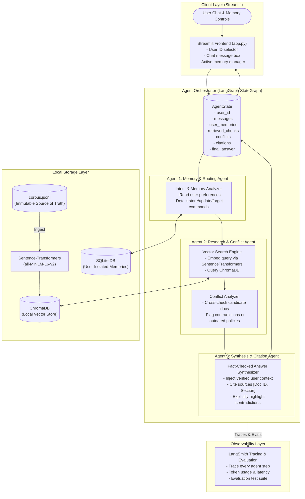

# Project Blueprint: "A Research Assistant That Remembers"

## 1. System Overview & Beginner-Friendly Architecture

This application is an AI-powered enterprise research assistant designed to answer questions from a company knowledge base (`corpus.jsonl`), cite authoritative evidence, detect conflicting documents, and maintain long-term, user-isolated memory across conversations.

### Architecture Diagram



---

## 2. The Three Distinct Agents Explained Simply

| Agent | Responsibility | Why It's Distinct |
| :--- | :--- | :--- |
| **1. Memory & Routing Agent** | • Reads active memories for the specific `user_id` from SQLite.<br>• Identifies if the user is asking to *store*, *modify*, or *forget* a preference.<br>• Injects relevant personal context into the prompt state. | Never performs document retrieval; focuses strictly on user identity, personalization, and memory lifecycle operations. |
| **2. Research & Conflict Agent** | • Embeds query and retrieves top matching chunks from local ChromaDB.<br>• Cross-examines retrieved documents for conflicting policies, differing dates, or contradictory facts. | Never generates answers for the user; specializes in retrieval accuracy and discrepancy detection. |
| **3. Synthesis & Citation Agent** | • Merges retrieved knowledge with detected conflicts and user context.<br>• Formulates answer with explicit citations (e.g., `[Doc #12, Page 2]`).<br>• Explicitly alerts user to document discrepancies. | Has no direct database access; acts as an objective writer and fact-checker. |

---

## 3. Proposed Folder Structure

```text
Mint-assignment/
├── app.py                      # Single-command Streamlit application entry point
├── corpus.jsonl                # Supplied knowledge base (kept completely untouched)
├── requirements.txt            # Minimal, pinned Python dependencies
├── .env.example                # Environment variables template
├── .gitignore                  # Ignores .env, chromadb data, virtual envs
├── README.md                   # Setup guide, cost analysis, and AI-use disclosure
│
├── src/
│   ├── __init__.py
│   ├── config.py               # Settings (paths, model names, env configs)
│   ├── database/
│   │   ├── __init__.py
│   │   ├── memory_store.py     # SQLite CRUD operations with user isolation
│   │   └── vector_store.py     # ChromaDB loader, SentenceTransformer embedder
│   ├── agents/
│   │   ├── __init__.py
│   │   ├── state.py            # TypedDict AgentState schema
│   │   ├── memory_agent.py     # Agent 1 logic
│   │   ├── research_agent.py   # Agent 2 logic & conflict detection prompt
│   │   ├── synthesis_agent.py  # Agent 3 logic & citation formatter
│   │   └── graph.py            # LangGraph compilation & workflow wiring
│   └── utils/
│       ├── __init__.py
│       └── ingestion.py        # One-time or auto-ingestion of corpus.jsonl
│
└── tests/
    ├── __init__.py
    ├── test_memory.py          # Tests memory isolation, updates, and forgetting
    ├── test_retrieval.py       # Tests local embeddings and vector search
    ├── test_conflicts.py       # Tests detection of conflicting documents
    └── test_evals.py           # Reproducible LangSmith evaluation runner
```

---

## 4. Dependencies & Required Environment Variables

### Recommended Dependencies (`requirements.txt`)
```text
# UI & Framework
streamlit>=1.35.0
langgraph>=0.2.0
langchain>=0.2.0
langchain-core>=0.2.0
langchain-community>=0.2.0

# Local Embeddings & Vector DB
sentence-transformers>=3.0.0
chromadb>=0.5.0
torch>=2.0.0

# Observability
langsmith>=0.1.75

# LLM Generation Model
langchain-openai>=0.1.8

# Testing
pytest>=8.0.0
```

### Required Environment Variables (`.env.example`)
```bash
# LangSmith Observability (Mandatory requirement)
LANGCHAIN_TRACING_V2=true
LANGCHAIN_ENDPOINT="https://api.smith.langchain.com"
LANGCHAIN_API_KEY="your-langsmith-api-key"
LANGCHAIN_PROJECT="research-assistant-remembers"

# LLM Generation Model
OPENAI_API_KEY="your-openai-key"

# Application Settings
EMBEDDING_MODEL_NAME="all-MiniLM-L6-v2"
CHROMA_DB_DIR="./data/chromadb"
SQLITE_DB_PATH="./data/memories.db"
CORPUS_PATH="./corpus.jsonl"
```

---

## 5. Step-by-Step Implementation Plan

### Step 1: Environment & Workspace Scaffolding
- Initialize project structure, `.env.example`, `.gitignore`, and `requirements.txt`.
- Set up SQLite database schema with composite primary or indexed user keys:
  ```sql
  CREATE TABLE IF NOT EXISTS memories (
      id INTEGER PRIMARY KEY AUTOINCREMENT,
      user_id TEXT NOT NULL,
      memory_key TEXT NOT NULL,
      memory_value TEXT NOT NULL,
      is_active BOOLEAN DEFAULT 1,
      created_at TIMESTAMP DEFAULT CURRENT_TIMESTAMP,
      updated_at TIMESTAMP DEFAULT CURRENT_TIMESTAMP
  );
  CREATE INDEX idx_user_id ON memories(user_id);
  ```

### Step 2: Ingestion & Local Vector Storage
- Build `src/database/vector_store.py`:
  - Read `corpus.jsonl` without modifying it.
  - Chunk and embed using `SentenceTransformer('all-MiniLM-L6-v2')` (runs locally, free, fast).
  - Store into local persistent ChromaDB collection.
  - Build metadata index capturing document IDs, titles, dates, and sections.

### Step 3: Implement User-Isolated Persistent Memory
- Build `src/database/memory_store.py`:
  - `get_user_memories(user_id)`: Fetches active context strictly isolated by `user_id`.
  - `save_memory(user_id, key, value)`: Adds or updates memory.
  - `forget_memory(user_id, key)`: Soft-deletes or removes memory.
  - `reset_user_memories(user_id)`: Clears user context on command.

### Step 4: Multi-Agent Orchestration with LangGraph
- Define `AgentState`:
  ```python
  class AgentState(TypedDict):
      user_id: str
      messages: list
      user_context: list[str]
      retrieved_docs: list[dict]
      conflicts_detected: list[str]
      citations: list[dict]
      final_answer: str
  ```
- Wire the three distinct agents in `src/agents/graph.py`:
  - `memory_agent` -> reads/modifies memory, enriches state with user profile.
  - `research_agent` -> queries ChromaDB, performs conflict analysis between chunks.
  - `synthesis_agent` -> writes response, lists citations, highlights discrepancies.

### Step 5: Streamlit Chat Interface (One-Command Launch)
- `streamlit run app.py` launches the whole system.
- Includes:
  - Sidebar for switching `User ID` (demonstrating user isolation live).
  - Active Memory Inspector showing current remembered facts with "Delete / Correct" buttons.
  - Chat window displaying formatted citations and conflict alert cards.

### Step 6: LangSmith Tracing & Reproducible Evaluations
- Configure tracing across all LangGraph nodes.
- Write `tests/test_evals.py` using LangSmith datasets/evaluators:
  - Metric 1: Citation accuracy (faithfulness to corpus).
  - Metric 2: Conflict detection rate (correctly identifying opposing claims).
  - Metric 3: Memory persistence & isolation across user sessions.

### Step 7: Documentation & Deliverables
- Setup instructions with exact terminal commands.
- Cost estimate documentation (e.g. gpt-4o-mini costs < $0.05 per 100 queries; embeddings are $0 local).
- AI-use disclosure outlining tools used during development.

---

## 6. Comprehensive Test Plan Matrix

| Requirement | Test File | Test Case Description | Pass Criteria |
| :--- | :--- | :--- | :--- |
| **User Memory Isolation** | `test_memory.py` | Store fact for User A ("Prefers Python"). Query as User B. | User B has zero access to User A's memory. |
| **Memory Correction** | `test_memory.py` | User A updates role from "Junior Dev" to "Tech Lead". | Old value overwritten or deactivated; only new value returned. |
| **Memory Forgetting** | `test_memory.py` | User A requests "forget my department". | Database marks memory inactive; state context is cleared. |
| **Local Embeddings** | `test_retrieval.py` | Test ChromaDB querying without internet/external API. | Correct chunks returned with similarity scores using local model. |
| **Conflict Handling** | `test_conflicts.py` | Feed 2 conflicting docs (e.g., 2022 vs 2024 policy). | Research agent flags conflict; synthesizer explicitly details both claims. |
| **Evidence Citation** | `test_retrieval.py` | Validate generated answers against source text. | Every assertion includes valid `[Doc ID]` citing source text. |
| **LangSmith Traces** | `test_evals.py` | Run LangGraph workflow with tracing enabled. | Valid Run ID generated in LangSmith dashboard. |
| **One-Command Run** | Terminal | Execute `streamlit run app.py`. | App launches automatically, loads local DBs, and serves on localhost. |
