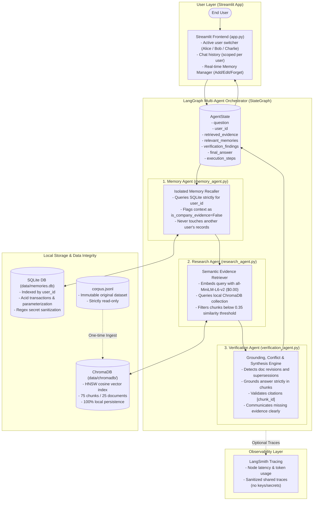

# System Architecture & Technical Design Note

**Project:** Asterline Multi-Agent Research Assistant ("A Research Assistant That Remembers")

---

## 1. System Architecture Diagram

---

## 2. Agent Responsibilities & Information Flow

### Agent 1: Memory Agent (`src/agents/memory_agent.py`)
* **Core Function:** Enforces user-isolated personal context recall.
* **Information Handled:** Receives `user_id` and `question`. Interacts with `SQLiteMemoryStore`.
* **Security & Boundary:** Always executes parameterized queries with `WHERE user_id = ?`. Formats memories as `[User Personal Context | ID:X]` and enforces `is_company_evidence = False`. User statements are never treated as facts about Asterline.

### Agent 2: Research Agent (`src/agents/research_agent.py`)
* **Core Function:** Gathers verified document evidence from the local knowledge base.
* **Information Handled:** Embeds the question using local Sentence Transformers (`all-MiniLM-L6-v2`) and searches the local persistent ChromaDB collection (`asterline_kb`).
* **Thresholding:** Discards chunks below `similarity_score < 0.35` to prevent false grounding on out-of-domain queries.

### Agent 3: Verification Agent (`src/agents/verification_agent.py`)
* **Core Function:** Evaluates grounding, detects document discrepancies, synthesizes the answer, and validates citations.
* **Conflict Resolution:** Cross-examines candidate chunks for:
  1. Multiple versions or publication dates of the *same document* (`doc_id`).
  2. Explicit supersession phrases (*"supersedes"*, *"deprecated"*, *"effective as of"*).
* **Grounding & Citations:** Validates that every citation `[chunk_id]` in the generated response maps to an authentic chunk in `retrieved_evidence`.
* **Uncertainty Communication:** If `retrieved_evidence` is empty, states clearly that documentation does not contain sufficient facts rather than fabricating an answer.

---

## 3. Technical Design Choices & Trade-offs

| Design Choice | Approach Selected | Alternative Considered | Rationale & Trade-offs |
| :--- | :--- | :--- | :--- |
| **Vector Storage** | **Local ChromaDB** | Cloud Vector DB (Pinecone, Qdrant Cloud) | **Local ChromaDB** runs entirely offline on disk with zero recurring hosting costs, zero network latency, and zero API dependency. |
| **Embeddings** | **SentenceTransformers (`all-MiniLM-L6-v2`)** | OpenAI `text-embedding-3-small` | **SentenceTransformers** is free, runs fast on CPU (~20ms per query), requires no API keys or internet connection, and never transmits data to third parties. |
| **User Memory Store** | **SQLite (`data/memories.db`)** | Redis / PostgreSQL | **SQLite** is built into Python's standard library, requires zero external services or daemon management, provides ACID guarantees, and easily handles thousands of user memories with B-tree indexing. |
| **Orchestration** | **LangGraph (`StateGraph`)** | LangChain `AgentExecutor` / autogen | **LangGraph** provides explicit, typed state transitions (`AgentState`), deterministic node sequencing, audit step logging, and native LangSmith tracing integration. |
| **Generation Model** | **OpenAI `gpt-4o-mini` with Deterministic Fallback** | Local Ollama / hosted Llama | `gpt-4o-mini` is extremely fast and cost-effective (~$0.00008/query). The architecture includes an automatic, deterministic grounded fallback that produces citations even without API keys. |
